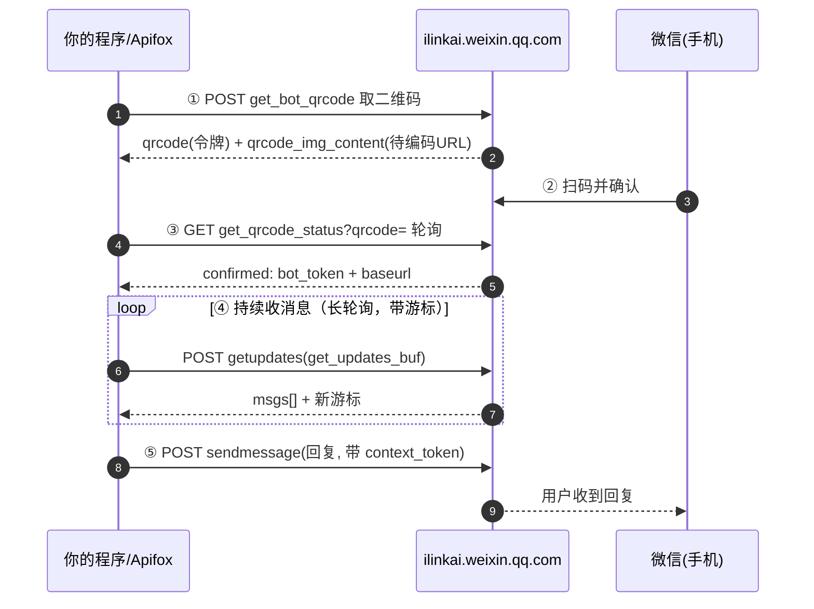

## agent连接微信ClawBot教程

### 一、登录与收发的全过程



---

### 二、接口协议

所有接口均为POST，请求和响应均为JSON。

#### 通用请求头（每个请求都要带）

| 头                        | 值                   | 说明                                    |
| ------------------------- | -------------------- | --------------------------------------- |
| `Content-Type`            | `application/json`   |                                         |
| `AuthorizationType`       | `ilink_bot_token`    | 固定                                    |
| `iLink-App-Id`            | `bot`                | 固定（插件 `ilink_appid`）              |
| `iLink-App-ClientVersion` | `132100`             | 版本 `2.4.4` 编码：`(2<<16)\|(4<<8)\|4` |
| `X-WECHAT-UIN`            | 见下                 | **每次请求随机生成**                    |
| `Authorization`           | `Bearer <bot_token>` | **登录后获取**；取码/轮询阶段不带       |

**`X-WECHAT-UIN` 怎么算**：随机一个 uint32 → 转十进制字符串 → base64。
例：`3847562901` → `"3847562901"` → base64 → `Mzg0NzU2MjkwMQ==`。

#### 接口列表

baseurl：`https://ilinkai.weixin.qq.com/ilink/bot`

| 接口                             | 路径                                             |
| -------------------------------- | ------------------------------------------------ |
| 获取二维码                       | `baseurl/get_bot_qrcode?bot_type=3`              |
| 长轮询扫码状态                   | `baseurl/get_qrcode_status?qrcode=&verify_code=` |
| 发送消息（文本/图片/视频/文件）  | `baseurl/sendmessage`                            |
| 长轮询获取消息                   | `baseurl/getupdates`                             |
| 获取 CDN 上传预签名 URL          | `baseurl/getuploadurl`                           |
| 获取账号配置（typing ticket 等） | baseurl/getconfig                                |
| 发送/取消输入状态指示            | `baseurl/sendtyping`                             |


##### 获取登录二维码 `get_bot_qrcode`

让服务端生成一张登录二维码。**谁扫这张码并确认，谁的微信号就成为这个机器人。**

**请求**

```http
POST https://ilinkai.weixin.qq.com/ilink/bot/get_bot_qrcode?bot_type=3
Content-Type: application/json
AuthorizationType: ilink_bot_token
iLink-App-Id: bot
iLink-App-ClientVersion: 132100
X-WECHAT-UIN: Mzg0NzU2MjkwMQ==

{"local_token_list": []}
```

- `bot_type=3`：插件写死的默认值（个人号 Bot 通道这一版），含义未公开，照用即可。

**响应**

```json
{
  "qrcode": "qrcode_token_xxxxx",
  "qrcode_img_content": "https://……(一段登录 URL，要把它编码成二维码给人扫)"
}
```

> ⚠️ `qrcode_img_content` **不是图片**，是「要编码进二维码的字符串」。要把它**渲染成二维码**再让微信扫
> （Apifox 里可把它贴到任意「在线二维码生成器」出图）。`qrcode` 是后面轮询用的令牌。

---

#####  轮询扫码状态 `get_qrcode_status`

拿着上一步的 `qrcode` 令牌，**反复查**直到用户扫码确认。这是个**长轮询**接口（服务端会 hold 住最多 ~35 秒再返回）。

**请求**

```http
GET https://ilinkai.weixin.qq.com/ilink/bot/get_qrcode_status?qrcode=qrcode_token_xxxxx&verify_code=
（公共请求头同上，此阶段不带 Authorization）
```

- `verify_code`：一般留空；只有状态变成 `need_verifycode` 时才填微信弹出的数字验证码。

**响应（状态机）**

```json
{ "status": "wait" }
```

`status` 取值：

| status                                    | 含义             | 你要做的                      |
| ----------------------------------------- | ---------------- | ----------------------------- |
| `wait`                                    | 等扫码           | 继续轮询                      |
| `scaned`                                  | 已扫、待手机确认 | 继续轮询                      |
| `need_verifycode`                         | 要数字验证码     | 带 `verify_code` 再轮询       |
| `confirmed`                               | **登录成功**     | 取出凭证（见下）              |
| `expired`                                 | 二维码过期       | 回第 2 步重新取码             |
| `verify_code_blocked`                     | 验证码错太多     | 重新取码                      |
| `binded_redirect` / `scaned_but_redirect` | 切服务器         | 按 `redirect_host` 切换后继续 |

**confirmed 时的响应**（关键！）：

```json
{
  "status": "confirmed",
  "bot_token": "bot_token_xxxxx",          // ← 之后所有请求的 Authorization: Bearer
  "baseurl": "https://ilinkai.weixin.qq.com/",  // ← 之后收发用这个 host
  "ilink_bot_id": "……",
  "ilink_user_id": "o9xxxxx@im.wechat",     // ← 绑定者的微信标识，可当通道 id
  "redirect_host": ""
}
```

把 `bot_token` 和 `baseurl` 存下来，后面收发都要用。

---

##### 收消息 `getupdates`（长轮询 + 游标）

不断「问」服务端有没有新消息。每次带一个**游标 `get_updates_buf`**（书签，标记读到哪），服务端只给书签之后的新消息并返回新书签。

**请求**

```http
POST https://ilinkai.weixin.qq.com/ilink/bot/getupdates
Authorization: Bearer bot_token_xxxxx
Content-Type: application/json
AuthorizationType: ilink_bot_token
iLink-App-Id: bot
iLink-App-ClientVersion: 132100
X-WECHAT-UIN: <每次随机>

{
  "get_updates_buf": "",
  "base_info": { "channel_version": "2.4.4" }
}
```

- 首次 `get_updates_buf` 传空串 `""`；之后**每次传上一次返回的新游标**。
- 这是长轮询：没新消息时服务端 hold ~35s 再返回（客户端超时建议设 40s）。

**响应**

```json
{
  "msgs": [
    {
      "from_user_id": "o9aaa@im.wechat",
      "message_type": 1,
      "context_token": "ctx_token_xxx",
      "item_list": [
        { "type": 1, "text_item": { "text": "在西安凯瑞B座小小怪店买2瓶可乐" } }
      ]
    }
  ],
  "get_updates_buf": "new_cursor_value"
}
```

处理要点：

- **游标只进**：把 `get_updates_buf` 存起来，下次带上；存盘后程序重启不会漏/重收。
- **只处理用户文本**：`message_type==1`(USER) 且 `item.type==1`(TEXT)；`message_type==2`(BOT) 是自己发的，丢弃。
- **记下 `context_token`**：回复时要原样带回去。
- 文本 = 把 `item_list` 里所有 `type==1` 的 `text_item.text` 拼起来。

---

##### 发消息 `sendmessage`

把回复发回给某个用户。**必须带回该消息的 `context_token`**，否则关联不到会话。

**请求**

```http
POST https://ilinkai.weixin.qq.com/ilink/bot/sendmessage
Authorization: Bearer bot_token_xxxxx
Content-Type: application/json
AuthorizationType: ilink_bot_token
iLink-App-Id: bot
iLink-App-ClientVersion: 132100
X-WECHAT-UIN: <每次随机>

{
  "msg": {
    "from_user_id": "",
    "to_user_id": "o9aaa@im.wechat",      // ← 收到消息里的 from_user_id
    "client_id": "随机唯一串",
    "message_type": 2,                     // BOT
    "message_state": 2,                    // FINISH
    "context_token": "ctx_token_xxx",      // ← 原样回传
    "item_list": [
      { "type": 1, "text_item": { "text": "已为你下单：可乐 2 瓶，合计 6 元。" } }
    ]
  },
  "base_info": { "channel_version": "2.4.4" }
}
```

**响应**：`{"errcode": 0, ...}` 表示成功。

> 长回复建议按 ~1000 字分多条发（在段落/句尾断开），避免被客户端截断。

---

##### 获取CDN上次预签名

作用：上传文件前需先调用此接口获取 `upload_param` 和 `thumb_upload_param`。

**请求体：**

```
{
  "filekey": "<文件标识>",
  "media_type": 1,
  "to_user_id": "<目标用户 ID>",
  "rawsize": 12345,
  "rawfilemd5": "<明文 MD5>",
  "filesize": 12352,
  "thumb_rawsize": 1024,
  "thumb_rawfilemd5": "<缩略图明文 MD5>",
  "thumb_filesize": 1040
}
```

| 字段               | 类型      | 说明                                 |
| ------------------ | --------- | ------------------------------------ |
| `media_type`       | `number`  | `1` = IMAGE, `2` = VIDEO, `3` = FILE |
| `rawsize`          | `number`  | 原文件明文大小                       |
| `rawfilemd5`       | `string`  | 原文件明文 MD5                       |
| `filesize`         | `number`  | AES-128-ECB 加密后的密文大小         |
| `thumb_rawsize`    | `number?` | 缩略图明文大小（IMAGE/VIDEO 时必填） |
| `thumb_rawfilemd5` | `string?` | 缩略图明文 MD5（IMAGE/VIDEO 时必填） |
| `thumb_filesize`   | `number?` | 缩略图密文大小（IMAGE/VIDEO 时必填） |

**响应体：**

```
{
  "upload_param": "<原图上传加密参数>",
  "thumb_upload_param": "<缩略图上传加密参数>"
}
```

------

##### 获取账号配置

获取账号配置，包括 typing ticket。

**请求体：**

```
{
  "ilink_user_id": "<用户 ID>",
  "context_token": "<可选，会话上下文令牌>"
}
```

**响应体：**

```
{
  "ret": 0,
  "typing_ticket": "<base64 编码的 typing ticket>"
}
```

------

##### 发送/取消输入状态显示

发送或取消输入状态指示。

**请求体：**

```
{
  "ilink_user_id": "<用户 ID>",
  "typing_ticket": "<从 getConfig 获取>",
  "status": 1
}
```

| 字段     | 类型     | 说明                           |
| -------- | -------- | ------------------------------ |
| `status` | `number` | `1` = 正在输入，`2` = 取消输入 |

### 三、消息结构

#### WeixinMessage

| 字段             | 类型             | 说明                                      |
| ---------------- | ---------------- | ----------------------------------------- |
| `seq`            | `number?`        | 消息序列号                                |
| `message_id`     | `number?`        | 消息唯一 ID                               |
| `from_user_id`   | `string?`        | 发送者 ID                                 |
| `to_user_id`     | `string?`        | 接收者 ID                                 |
| `create_time_ms` | `number?`        | 创建时间戳（ms）                          |
| `session_id`     | `string?`        | 会话 ID                                   |
| `message_type`   | `number?`        | `1` = USER, `2` = BOT                     |
| `message_state`  | `number?`        | `0` = NEW, `1` = GENERATING, `2` = FINISH |
| `item_list`      | `MessageItem[]?` | 消息内容列表                              |
| `context_token`  | `string?`        | 会话上下文令牌，回复时需回传              |

#### MessageItem

| 字段         | 类型                | 说明                                                |
| ------------ | ------------------- | --------------------------------------------------- |
| `type`       | `number`            | `1` TEXT, `2` IMAGE, `3` VOICE, `4` FILE, `5` VIDEO |
| `text_item`  | `{ text: string }?` | 文本内容                                            |
| `image_item` | `ImageItem?`        | 图片（含 CDN 引用和 AES 密钥）                      |
| `voice_item` | `VoiceItem?`        | 语音（SILK 编码）                                   |
| `file_item`  | `FileItem?`         | 文件附件                                            |
| `video_item` | `VideoItem?`        | 视频                                                |
| `ref_msg`    | `RefMessage?`       | 引用消息                                            |

#### CDN 媒体引用 (CDNMedia)

所有媒体类型（图片/语音/文件/视频）通过 CDN 传输，使用 AES-128-ECB 加密：

| 字段                  | 类型      | 说明                       |
| --------------------- | --------- | -------------------------- |
| `encrypt_query_param` | `string?` | CDN 下载/上传的加密参数    |
| `aes_key`             | `string?` | base64 编码的 AES-128 密钥 |

### CDN 上传流程

1. 计算文件明文大小、MD5，以及 AES-128-ECB 加密后的密文大小
2. 如需缩略图（图片/视频），同样计算缩略图的明文和密文参数
3. 调用 `getUploadUrl` 获取 `upload_param`（和 `thumb_upload_param`）
4. 使用 AES-128-ECB 加密文件内容，PUT 上传到 CDN URL
5. 缩略图同理加密并上传
6. 使用返回的 `encrypt_query_param` 构造 `CDNMedia` 引用，放入 `MessageItem` 发送

